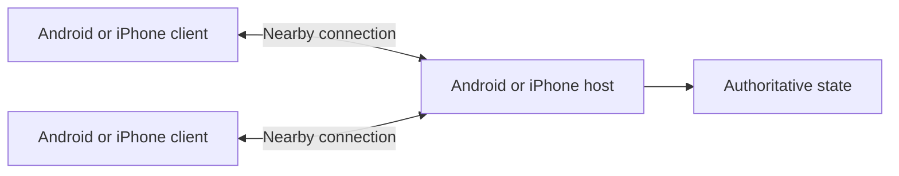
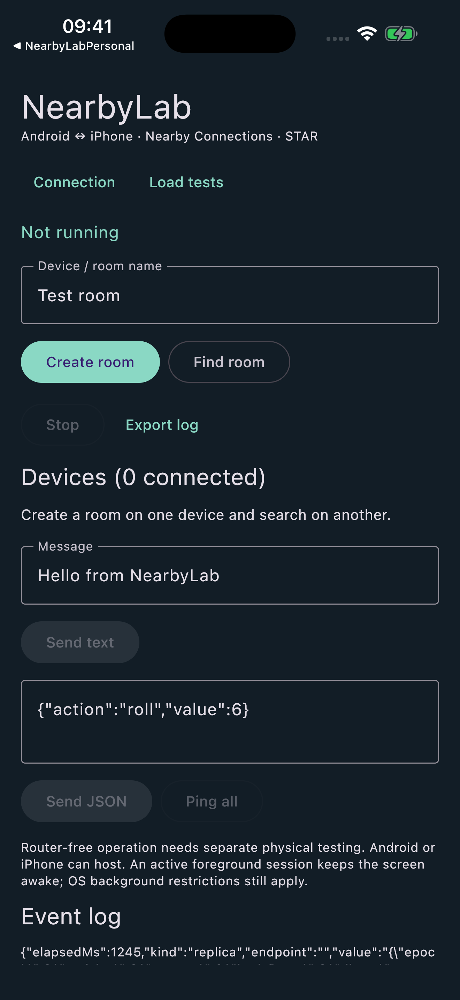

# NearbyLab

**Android ↔ iPhone connections, shared Kotlin logic, and a benchmark you can run yourself.**

[](https://github.com/bigmeco/nearby-connections-kmp/actions/workflows/ci.yml)
[](LICENSE)
[](https://kotlinlang.org/multiplatform/)

[Русский](README.ru.md) · [Build & run](docs/BUILDING.md) · [Load testing](docs/LOAD_TESTING.md) · [Physical results](docs/BENCHMARKS.md) · [Architecture](docs/ARCHITECTURE.md)

NearbyLab is an independent Kotlin Multiplatform example of **Google Nearby Connections** for local multiplayer experiments. Create a room on Android or iPhone, verify the connection on both screens, exchange text/JSON, and measure how a host distributes state to several clients.

The Android adapter uses Google Play Services; the iOS adapter uses Google's Swift SDK. Compose Multiplatform, the protocol, load generator, metrics and state replication are shared. The UI supports English and Russian.

> **Status: experimental lab, version 0.2.0.** Android–iPhone messaging and three-device state replication were exercised on physical hardware. Discovery and host handoff still have unresolved cases. This is a reproducible starting point, not a production networking library or an official Google sample.

## What you can try

| Area | Included |
| --- | --- |
| Connections | Android or iPhone host, STAR topology, discovery, manual code verification, disconnect/reconnect |
| Messaging | UTF-8 text, JSON, application receipts, ping/pong RTT |
| Load | 64 B–1 MiB logical payloads, fixed rate or maximum mode, bounded in-flight window, size/rate sweep |
| Multiplayer | Client command → authoritative host → state broadcast → receipts from all clients |
| Multiple senders | Host starts coordinated load on connected clients and collects their reports |
| Host handoff | Planned snapshot transfer, role switch, rediscovery and fresh verification; manual takeover experiment |
| Diagnostics | p50/p95/p99/max latency, useful goodput, timeouts, queue peaks, integrity checks, NDJSON export |



This is a **star**, so two clients appear as two separate connections at the host. Client-to-client communication goes through application code on the host. Text/JSON is sent to the device's direct peers; the load panel's **Command → state to all** mode explicitly implements the relay.

## Quick start

Requirements: **JDK 21**, Android SDK **37.0** / build tools **37.0.0**, and Google Play Services on Android. For iOS, use a Mac and a recent Xcode; the checked build used **Xcode 26.5**. See [exact versions and signing](docs/BUILDING.md).

```sh
git clone https://github.com/bigmeco/nearby-connections-kmp.git
cd nearby-connections-kmp
# Set JAVA_HOME to your JDK 21 and ANDROID_HOME to your Android SDK.
./gradlew :shared:jvmTest :androidApp:assembleDebug
```

Install `androidApp/build/outputs/apk/debug/androidApp-debug.apk` on Android. On a Mac, open `iosApp/NearbyLab.xcodeproj`, configure your own [local signing settings](docs/BUILDING.md#iphone-signing), and run **NearbyLabPersonal** on an iPhone. The repository contains no signing identity.

1. Keep both apps open and grant Bluetooth / nearby-device / local-network permissions.
2. On one device choose **Create room**. On another choose **Find room → Connect**.
3. Compare the displayed code independently on both devices, then choose **Code matches** on each. Reject a mismatch.
4. Send text and JSON in both directions; try **Ping all**.
5. Add a second client. On **Load tests**, start with **64 bytes, 1 message/s, 5 seconds, window 1**.
6. Export logs from every device. Increase load gradually using the [test guide](docs/LOAD_TESTING.md).

Nearby discovery needs physical devices. A simulator build checks integration and UI, not radio interoperability.

## What the measurements say

Selected results from **9 November 2026**; these are short observations on three particular devices, not SDK performance guarantees. “Completed” means an application-level receipt, rather than a successful SDK send callback.

| Scenario | Completed | p95 full exchange | Useful goodput |
| --- | ---: | ---: | ---: |
| Android → Android, 1 KiB at 10/s | 100 / 100 | 270 ms | 10,136 B/s |
| Android → Android, 256 KiB at requested 5/s | 25 / 25 | 2,363 ms | 867,452 B/s |
| Android → Android, 1 MiB at requested 5/s | 9 / 9 | 8,115 ms | 855,049 B/s |
| iPhone client → Android host → both clients, 64 B at 1/s | 5 / 5 | 486 ms | 63 B/s |
| Two Android clients → iPhone host → both clients, 64 B at 1/s each | 5 / 5 each | 827 / 865 ms | 63 B/s per sender |

The 1 MiB run **did not sustain 5 messages/s**. Generation was limited by the window, and goodput includes the time spent draining receipts. The Android bulk runs do not establish iPhone bulk capacity. Earlier iPhone load runs timed out and were confounded by screen locking / foreground interruptions.

A two-device Android host handoff recovered in about 50 seconds **including manual verification**. A three-device handoff to iPhone exceeded its 120-second deadline; manual reconnection later restored all replicas. Both outcomes are documented in the [full report, including failures and network conditions](docs/BENCHMARKS.md).

## Important boundaries

- **No common Wi-Fi network** and **both Wi-Fi radios fully off at cold start** are different tests. Router-free exchanges were observed, but a strict cold-start test with both radios continuously off was not established. The SDK's active radio transport is not measured by this app.
- **NearbyLabPersonal** requests BLE and Wi-Fi LAN only, with no restricted entitlements. **NearbyLab** requests the pinned SDK's wider medium set and needs suitable signing capabilities. Selecting a medium does not prove that it was used or that it works across platforms.
- Handoff has fresh manual verification, a deadline and an in-memory snapshot. It has no leader election, persistent recovery or partition consensus. A process restart loses state.
- Keep the apps in the foreground. Active sessions keep the screen awake, but background execution is still subject to OS restrictions.
- The benchmark uses synthetic ASCII payloads and JSON fragmentation, runs on the app thread, and measures this implementation. It does not measure maximum radio bandwidth, battery life or production game scalability.
- This example has not been submitted to App Store / Google Play review. Release signing, privacy declarations, dependency manifests and store requirements need their own audit.

## Repository map

```text
shared/       Compose UI, protocol, load engine, replication, JVM tests
androidApp/   Google Play Services adapter, permissions, log export
iosApp/       Swift Nearby adapter, Xcode host, local signing configuration
tools/        Offline NDJSON report reader
docs/         Build guide, methodology, architecture and curated physical results
.github/      Android/JVM checks and manual unsigned iOS build workflow
```

The SDK versions are deliberately pinned: Android **19.5.1** and Apple commit [`a95eba7`](https://github.com/google/nearby/tree/a95eba75022cc1d00f0898bbde5e6ad03ee71ba2). See [dependencies](docs/DEPENDENCIES.md) before updating either side. The Android and Swift SDKs expose different human-readable verification formats; the Android adapter normalizes the raw token to the pinned Swift format without logging or transmitting that token.

## UI preview



*iOS simulator preview, disconnected. Physical results are documented separately above.*

## Contributing and license

See [CONTRIBUTING.md](CONTRIBUTING.md) for checks and a useful device-test report. Raw device logs, provisioning profiles and local signing settings are intentionally excluded.

NearbyLab is available under [Apache-2.0](LICENSE). Dependencies retain their own licenses; see [NOTICE](NOTICE). Google Nearby Connections is a Google technology; this project is independently maintained.
