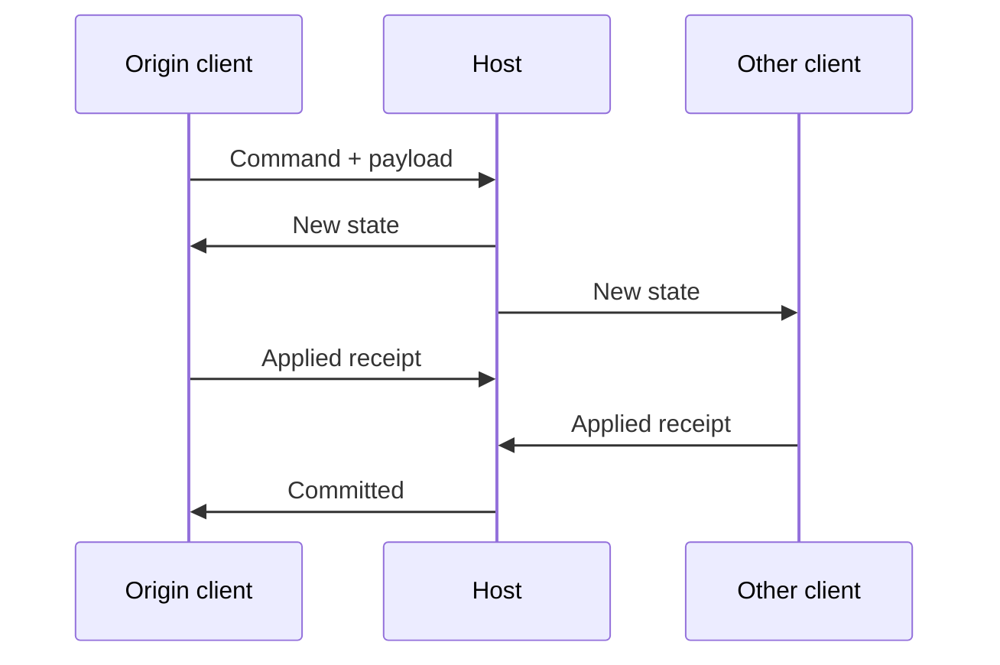

# Load testing and metric definitions

The lab measures complete application exchanges over Nearby, including the cost of this implementation's scheduling, JSON framing, processing and receipts. It does not measure raw Bluetooth/Wi-Fi throughput.

## First run

1. Install compatible builds on every participant. Create one room, connect clients and compare every connection's code on both screens.
2. Keep all apps foreground and unlocked. Record the network state before changing it.
3. Open **Load tests** and begin with **64 B, 1 message/s, 5 seconds, window 1**. Apply the parameters before starting.
4. Run **Delivery + receipt** first. Then run **Command → state to all** on a client, with all other clients connected.
5. Check completion counts, timeouts and replica checksums before increasing rate / size.
6. Export NDJSON from the **Connection** tab on every device.

Do not run competing hosts for the same session. Plain text/JSON messages are not automatically relayed; use the load panel's explicit replicated-state scenario for fanout.

## Parameters and scheduling

| Parameter | Range / meaning |
| --- | --- |
| Payload size | 64–1,048,576 bytes of synthetic ASCII data, excluding envelopes |
| Rate | 0–1,000 logical broadcasts per second; 0 uses the available window / queue |
| Duration | 1–600 seconds of generation, followed by receipt draining |
| Window | 1–128 outstanding deliveries, summed across recipients |
| Receipt timeout | 1–60 s in `LoadPlan`; UI uses the 10 s default |

For echo from a host with two clients, one broadcast is two separately counted deliveries. The window must fit at least one full broadcast. An offered rate is a target; backpressure and the main-thread scheduler may achieve less.

The engine ticks every 20 ms, schedules at most 32 broadcasts per tick and pumps at most 32 frames per tick. UI metrics update about every 250 ms. The main thread, serialization and chunk pump can limit results independently of the SDK.

### Delivery + receipt (`ECHO`)

The initiator sends a logical payload to every direct peer. Each recipient reassembles and validates it, then returns a small receipt. Latency runs from local enqueue to receipt on the initiator's monotonic clock. **The whole payload is not echoed back.**

### Command → state to all (`RELAY`)

Start this on a client. The host validates the command, increments its authoritative revision/counter and broadcasts a snapshot to all current clients, including the origin. Every client validates and acknowledges the snapshot. The host sends `committed` to the origin only after all required receipts arrive.



Latency covers this whole barrier. A slow recipient affects the origin's result. It is not simply the first network hop. This synthetic state is public to every client; hidden card hands and private player projections are not implemented.

### Run clients

The host requests the selected relay plan on all already verified clients concurrently. Each client records its own result and returns a report. Reports are correlated with the coordinated request; a late report cannot complete a newer group. The host waits for reports or cancellation before allowing another group. Missing reports produce `load_remote_timeout`.

This button runs one selected plan, not the full sweep on every client.

### Size / rate sweep

Each stage generates for 5 seconds and drains pending receipts with a 10-second timeout:

- 64 / 1,024 / 8,192 / 16,384 / 65,536 / 262,144 / 1,048,576 B at 5/s, window 8.
- 256 B at 10 / 50 / 200 / 1,000/s and maximum, window 64.

The generator and remaining sweep stop on the **first receipt timeout**. This avoids continually refilling an SDK queue whose contents the app cannot inspect. Cancel stops generation and removes unsent data for that run; it cannot retract fragments already submitted to the SDK.

## Read the metrics correctly

| Metric | Definition |
| --- | --- |
| `sent` | Logical recipient deliveries admitted to the application queue |
| `delivered` | Complete exchanges confirmed by an application receipt |
| `timedOut` | No complete receipt by the deadline; not proof of a lost radio packet |
| `failed` | Explicit failure / disconnect of a pending exchange |
| `cancelled` | Pending exchanges settled by cancellation |
| Goodput | `deliveredBytes × 1000 / elapsedMs`, including the final receipt drain |
| p50 / p95 / p99 | Nearest-rank latency of successful exchanges, 1 ms histogram bins |
| `wireTxBytes` / `wireRxBytes` | UTF-8 bytes of this app's load JSON frames, excluding radio / SDK overhead |
| `peakPending` | Maximum outstanding logical deliveries |
| `peakQueuedBytes` | Peak of the application's unsent serialized-character budget |
| `limitedTicks` | Ticks when admission / window constraints limited generation |
| Duplicates | Repeated / late application receipts or fragments; not proof of SDK packet duplication |
| Out of order | Application sequence observations; not a measurement of raw radio reordering |
| Corrupt | Failed logical length / checksum / reassembly validation |

For a settled run, check `sent = delivered + timedOut + failed + cancelled`. Good percentiles do not cancel out failures: always report sample counts and timeouts together. Empty successful samples have zero-valued latency fields, which do not mean zero latency. Histogram percentile bins saturate at 60 s; the separate `max` retains the observed maximum.

In relay mode, useful bytes are the **origin's command payload**, not the sum of every state copy. Wire counters include all load traffic on that device during the interval, including concurrent flows. They cannot always be assigned to a single sender. Session counters on the panel are cumulative, whereas result counters cover the run interval.

No wall-clock synchronization between devices is needed: all exchange durations use one initiator's monotonic clock. A 5-sample p95 is effectively the maximum; it does not characterize a long session.

## Bounds and integrity

- Each shared wire envelope is capped at **16,384 UTF-8 bytes**.
- Load messages are fragmented into **4,500-character** chunks; the logical serialized message cap is 2 MiB.
- The outbound application queue has an 8 MiB serialized-character budget and 512 queued entries. Reassembly reserves at most 8 MiB / 64 assemblies, with a 60 s TTL. Synthetic ASCII makes character and payload byte counts comparable; these limits do not describe total process memory, JSON escaping or SDK buffers.
- The outgoing pump rotates data messages and prioritizes control operations while preserving their FIFO order.
- The host bounds pending fanout; a full snapshot must fit the admission limits.
- FNV-1a checksums detect accidental corruption for this experiment. They are not cryptographic authentication, anti-cheat or a substitute for Nearby connection verification.

Per-payload success events and bulk bodies are excluded from persistent benchmark logging to reduce I/O bias. Ordinary text/JSON messages are logged. Once per second, `load_traffic` records frame-byte counters, queue peaks, synchronous SDK-send exceptions and fanout backlog. Asynchronous transport failures appear separately; a zero synchronous-exception counter does not prove every send succeeded.

## Host handoff

**Planned:** freeze/cancel load → prepare next-epoch snapshot → wait for ready → commit → role switch → discover the expected node → compare fresh connection codes → match snapshot hashes. The new host waits for all expected members. An uncommitted prepare does not change the live replica. Recovery has a **120 s** deadline; elapsed time includes user verification.

If commit acknowledgement is lost, the old host still steps down. Partial commits and network partitions can require manual recovery: this is not a consensus protocol. A connection established after the deadline is usable but does not turn a failed handoff into a successful timed recovery.

**Manual takeover:** after the old host is disconnected, select exactly one surviving client and choose **Become host with snapshot**. Other clients refresh discovery and verify new connections. Takeover is refused while the old host is still connected. Snapshots and node identity are in memory only; restarting all processes loses the session. Automated election and physical crash recovery are not established.

## Export and compare

```sh
python3 tools/read-load-results.py path/to/exported-logs --output report.json
```

The reader accepts files or directories, deduplicates local/remote reports by run ID and prefers the local result. It reports source paths, replicas, load/migration failures, goodput and accounting checks. It fills documented 0.2 defaults omitted by early 0.2 exports. Keep the generated report private until reviewed: source paths, device names and ordinary messages may contain personal information.

Use [the physical report](BENCHMARKS.md) as an example of reporting successes and failures together. The curated JSON in that document is a separate public summary format, not an input log for this reader.
